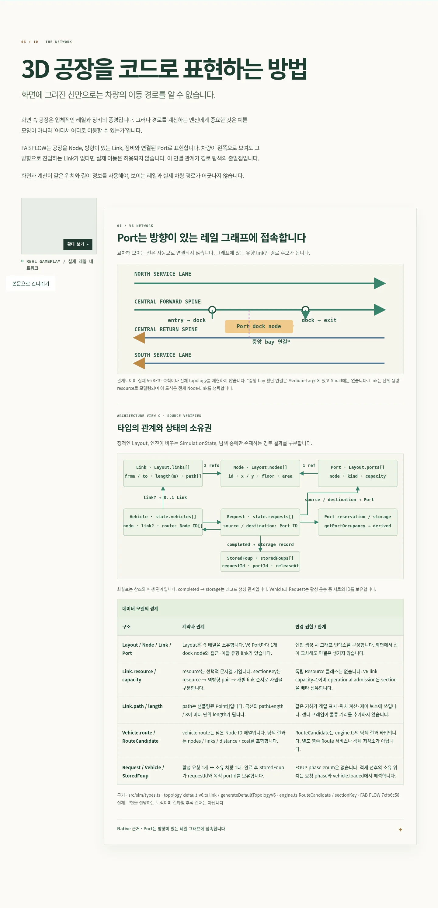
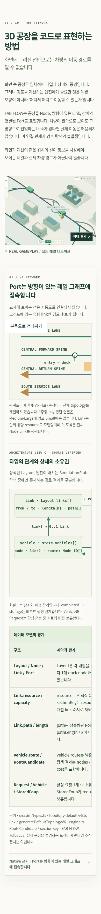
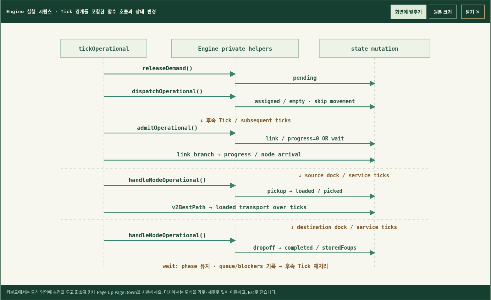
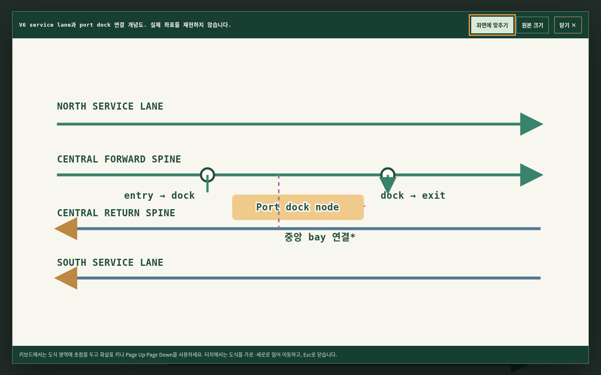

# Work6 visual review · 2026-11-05

The review covered the existing 11-chapter article at these Chromium viewports: 1920×1080, 1440×900, 1366×768, 1024×768, 768×1024, 844×390, 390×844, 360×740, and 320×720. All nine rendered without page-width overflow. The verified static Hero image remains unchanged.

## Round 1 · diagram fit issue

These saved baseline captures were rendered from the initial commit in local Chromium before the visual changes. At phone width the wide data-model diagram and table continue beyond the viewport; the reader only gets the inline horizontal scroll region. Chapters 06–09 also put a lot of implementation detail on screen at once. Scannable diagram actions, stronger view headings, clearer module cards, and distinct function/state labels were added while retaining every table and source note.

The first actual sequence-viewer capture, after its first implementation, showed that the “fit” view shrank to width but left its lower steps below the viewport. This intermediate screenshot is the round-one correction target. The mobile original-size view also needed an explicit touch instruction. This led to fitting SVGs to both viewer dimensions, leaving mobile viewers in original-size scroll mode, and adding arrow/Page/Home/End keyboard scrolling plus a touch-drag hint.

## Round 2 · corrected viewer and phone review

The second local Chromium review checked Chapters 06–09 inline and opened the V6 diagram viewer at 1440×900 and 390×844. Desktop fit mode shows the complete diagram; the mobile viewer starts at readable original scale and supports horizontal and vertical scrolling. `Esc` closes it, focus returns to its opener, and the page scroll lock is released. The SVG copy gets unique IDs and preserves marker-arrow references.

Additional [desktop inline](round-2/engineering-desktop-inline.png) and [desktop viewer](round-2/diagram-viewer-desktop-fit.png) captures show the same review state. The earlier sequence viewer and its final fit-mode version are also preserved under [screenshots](screenshots/).

## Interaction and accessibility checks

- The focused browser smoke passed at all nine viewports with 11 chapters, no page errors, no failed network responses, no horizontal document overflow, and the Hero CTA visible in the first viewport.
- The diagram test checks fit/original controls, unique IDs while open, Escape close, opener focus return, page scroll restoration, and ArrowRight movement in the 390px original-size view.
- A mobile Playwright page requested no MP4 before playback, played the 9.6-second clip after user initiation, and advanced the playhead. A separate 320×720 test aborted the MP4 request and confirmed the static poster fallback appeared.
- axe-core WCAG 2 A/AA and WCAG 2.1 AA reported zero violations for the full page and open diagram viewer at 1440×900 and 390×844. Automated checks do not replace a complete accessibility review.

The new Chapter 02 clip uses `controls`, `playsInline`, `muted`, and `preload="none"`; it has a poster, a working MP4 link, and an error fallback. It does not autoplay or loop. The Hero stays on its existing static capture.

These checks exercised the local production build. They do not establish behavior on every physical device or live deployment; the separate deployed-site review is recorded in the delivery notes.
